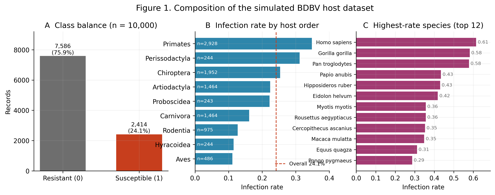
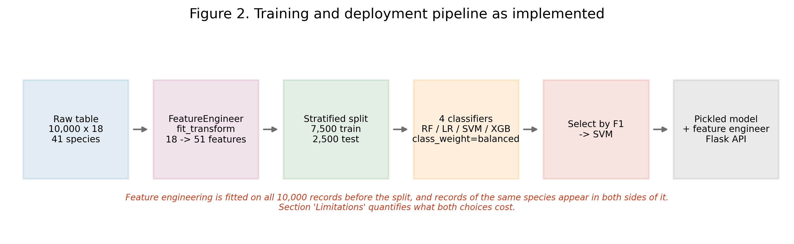
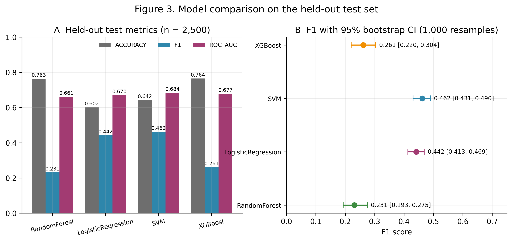
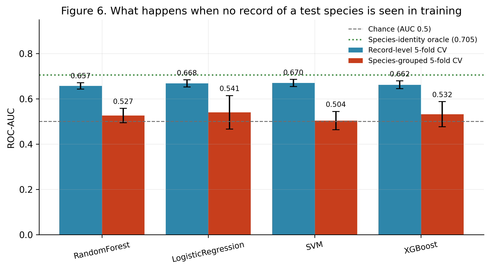
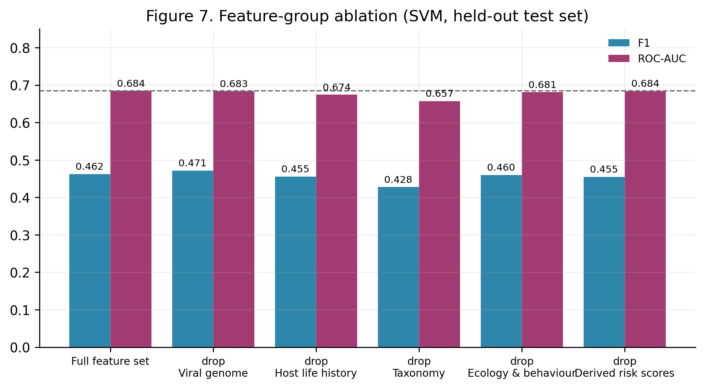
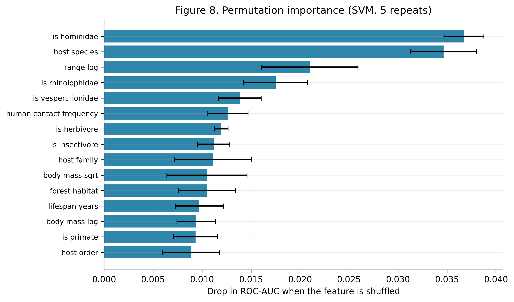
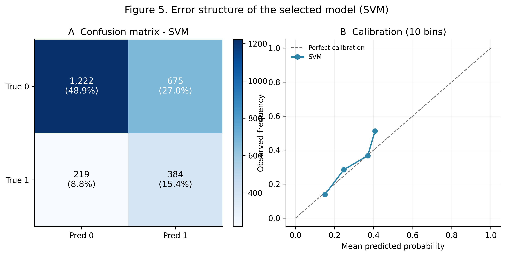
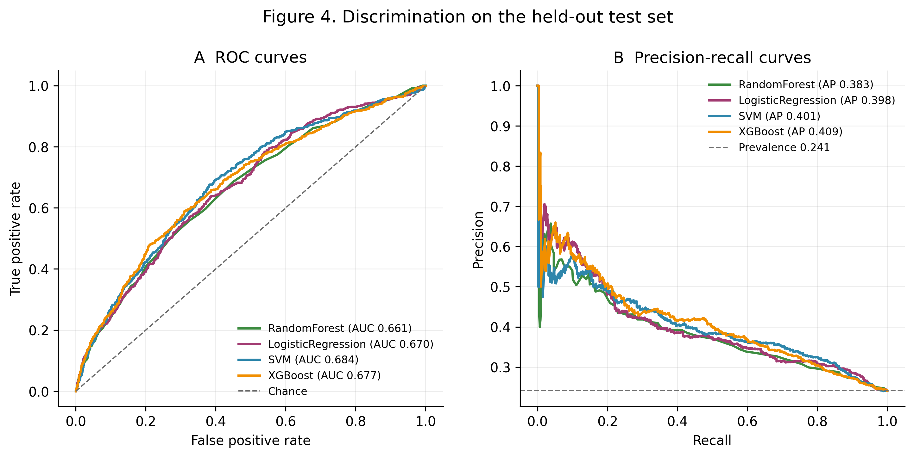
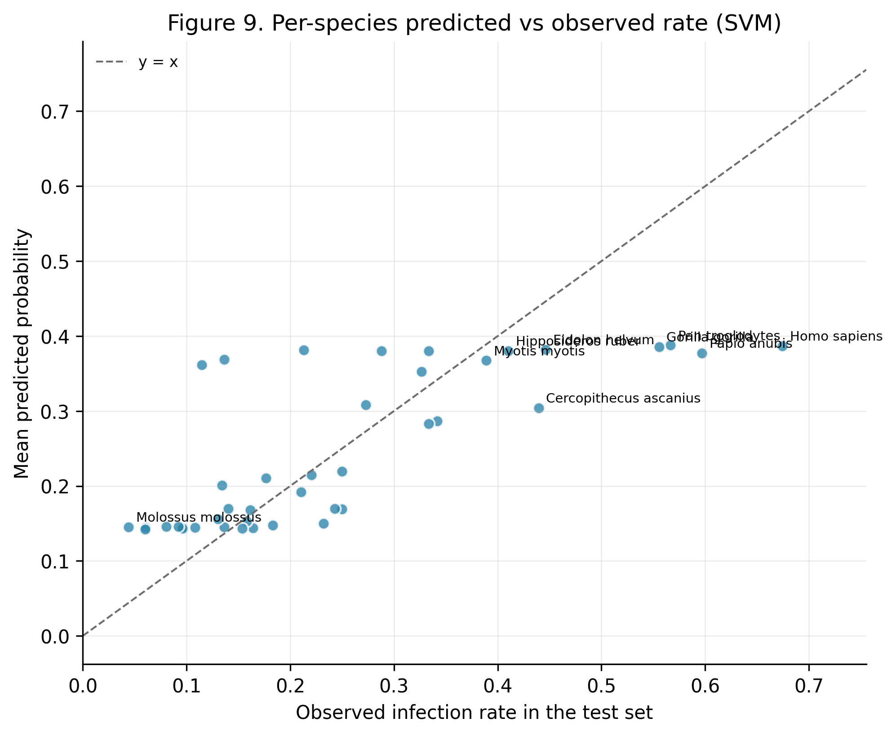

# Predicting Bundibugyo virus host susceptibility from host traits: a pipeline study on simulated data

A machine-learning study of whether host biology, ecology and taxonomy can predict which
animal species are susceptible to Bundibugyo virus (BDBV), together with the full pipeline
that produces the result: feature engineering, four classifiers, cross-validation, ablation,
explainability, and a Flask service that serves predictions for species inside and outside
the reference table.

**The headline finding is negative, and that is the point of the write-up.** On a conventional
random split the selected model reaches ROC-AUC 0.684. When the evaluation is changed so that
no record of a test species is ever seen during training, performance falls to ROC-AUC 0.504 —
chance. Almost all of the apparent skill is the model recognising *which species a row belongs to*,
not learning a trait-to-susceptibility rule that transfers to a new species. Everything below
documents how that conclusion was reached and what it costs the intended application.

---

## 1. Background and motivation

Bundibugyo virus (BDBV) is a filovirus first identified in the 2007 outbreak in Bundibugyo
District, western Uganda, and described the following year as a species distinct from the other
ebolaviruses, differing from them by more than 30% at the genome level [1]; it was formally
placed in the revised Filoviridae taxonomy as *Bundibugyo ebolavirus* [2]. Like the other
filoviruses, its maintenance host range is only partly known. The evidence that exists points
towards bats — Ebola virus antibodies and RNA were found in three fruit bat species [3], and
Marburg virus was isolated from wild *Rousettus aegyptiacus* [4] — but surveillance is sparse
and geographically uneven, and the species that have never been sampled vastly outnumber the
ones that have.

That gap is the usual motivation for host-prediction models. If susceptibility were predictable
from traits that are already catalogued for thousands of mammals — body mass, lifespan, diet,
roosting and social behaviour, range size, degree of contact with people — then a model could
rank unsampled species and tell field programmes where to look first. This is an established
line of work: host and viral traits have been used to predict zoonotic spillover across mammals
[5], and trait-based classifiers have been used to flag rodent species as likely reservoirs of
future zoonoses [6]. It is also contested — a comparison across 415 viruses found the proportion
of zoonotic viruses to be roughly constant across host orders, which argues that host traits may
carry less predictive weight than the approach assumes [7].

This project asks the narrower, prior question: **given a trait table of this shape, does a
standard supervised pipeline actually learn a transferable rule, or does it learn the species
labels?** The question matters because the answer determines whether a model of this kind can be
used for its intended purpose at all. A model that scores well on a random split and fails on
unseen species is useless for ranking unsampled species, which is the only thing anyone wants
it for.

### What this project is, and is not

The dataset in `data/raw/filovirus_data_template.csv` is **simulated**, not curated surveillance
data. It contains 10,000 records over 41 named species, roughly 244 rows per species, with
continuous trait values drawn around a per-species profile and infection labels drawn
stochastically. The repository's own generator (`src/data/generator.py`) states the same thing
and notes that the encoded associations — higher risk for primates and pteropodid bats, for
instance — are hypothesised from the published host range [3, 4] rather than measured. The viral
constants it draws around (genome ≈ 18,950 bp, GC ≈ 41%, glycoprotein ≈ 676 aa) are in the right
range for a filovirus [2], but the per-species trait values and every label are generated.

So the numbers below are **statements about the pipeline, not about filovirus biology**. No
species should be called a BDBV host or non-host on the strength of anything in this repository.
What does transfer to real work is the methodology: the evaluation design that exposed the
failure, and the size of the gap it exposed.

---

## 2. Data



**Figure 1.** Composition of the dataset. (A) Class balance. (B) Infection rate by host order,
with per-order record counts. (C) The twelve species with the highest infection rate.

| Property | Value |
|---|---|
| Records | 10,000 |
| Columns in the raw table | 18 |
| Species | 41 |
| Families / orders | 22 / 9 |
| Records per species | 244 for 37 species, 243 for the other 4 |
| Virus | BDBV only |
| Positive class (`infection_status` = 1) | 2,414 (24.14%) |
| Missing values | 0 |

Each row carries a virus name, five viral columns (genome length, GC content, CpG frequency,
glycoprotein length, glycoprotein hydrophobicity), three continuous host traits (body mass,
lifespan, geographic range), four categorical traits (diet, social behaviour, habitat,
human-contact frequency), four taxonomic fields (species, genus, family, order) and the binary
label.

Two properties of the data drive everything that follows.

**The viral columns carry no between-row signal that matters.** Every record is BDBV, so those
columns vary only as noise around a single virus profile. Section 5.4 confirms they are
dispensable.

**Labels are stochastic within a species.** No species is uniformly susceptible: *Homo sapiens*
sits at 61.5% positive, *Gorilla gorilla* at 58.2%, *Pan troglodytes* at 57.8%, and at the other
end *Nycteris gambiensis* at 7.0% and *Canis familiaris* at 8.6%. Because a species' rows share one trait profile plus noise, the *best possible*
classifier on this data is one that recovers each species' underlying rate. That sets a ceiling,
measured in Section 5.5, which no model can exceed and which turns out to be close to what the
models actually achieve.

Infection rate by order follows the pattern the generator was built to encode: Primates 34.8%,
Perissodactyla 31.1%, Chiroptera 25.4%, down to Aves 11.1%.

---

## 3. Methods



**Figure 2.** The pipeline as implemented in `scripts/run_training.py`, including the two
evaluation choices that Section 7 shows to be consequential.

### 3.1 Feature engineering

`src/features/engineering.py` expands the 18 raw columns to **51 features**:

| Group | Count | Examples |
|---|---|---|
| Viral genome | 10 | `gc_content`, `gc_content_squared`, `cpg_density`, `gp_hydro_abs` |
| Host life history | 7 | `body_mass_log`, `body_mass_sqrt`, `lifespan_log`, `range_log` |
| Taxonomy | 13 | `host_species`, `host_family`, `is_primate`, `is_pteropodidae`, `taxonomic_risk` |
| Ecology and behaviour | 16 | `human_contact_score`, `social_group_score`, `cave_habitat`, `is_frugivore` |
| Derived risk scores | 4 | `bdbv_risk`, `baseline_risk`, `combined_risk`, `high_risk` |

The 51st feature is `virus`, which is constant on this dataset. So is `bdbv_risk`, for the reason
given below.

Categorical columns are label-encoded and numeric columns standardised. Missing numeric values
get a `<col>_was_missing` indicator and a median fill, with the medians stored at fit time.

Two implementation details are worth recording because they affect how the results should be
read.

First, **`host_species` survives into the feature matrix as a label-encoded integer**. The model
is handed species identity directly. Section 5.5 shows this is among the most useful things it
receives.

Second, several engineered features **never fire on this dataset**, because the engineering code
expects the generator's canonical column names (`virus_species`, `gp_length`, `genome_length`)
while the CSV uses `virus`, `glycoprotein_length`, `viral_genome_length`. The `is_bdbv`/`is_ebov`
family, `gp_length_ratio`, and the taxonomic bumps inside `bdbv_risk` are all computed from
columns that are absent, so `bdbv_risk` stays identically zero. The loader logs this as
`Missing required columns: ['virus_species']` on every run. The practical effect is small here —
one virus, so those features would be near-constant anyway — but the ablation in Section 5.4 is
measuring a `bdbv_risk` that is a column of zeros, and that is worth knowing.

### 3.2 Models

Four classifiers from `src/models/classical.py`, three from scikit-learn [11] and one from
XGBoost [12], all with `class_weight="balanced"` to handle the 24% positive rate, all seeded with
`random_state=42`:

- **Random Forest** — 100 trees, unlimited depth
- **Logistic Regression** — L2, `C=1.0`, lbfgs, 1,000 iterations
- **SVM** — RBF kernel, `C=1.0`, `gamma="scale"`, probabilities enabled
- **XGBoost** — 100 rounds, depth 6, learning rate 0.1, subsample 0.8

Model selection uses F1 rather than accuracy, which is the right call on a 76/24 split: a model
that predicts "resistant" for every row scores 0.759 accuracy and is worthless.

### 3.3 Evaluation

Stratified 75/25 split (7,500 train, 2,500 test), seed 42. Reported metrics are accuracy,
balanced accuracy, precision, recall, F1, MCC, ROC-AUC and average precision. Confidence
intervals are percentile bootstrap over 1,000 resamples of the test set.

---

## 4. Experiments

Seven experiments, all reproduced by one script (`scripts/generate_paper_figures.py`), which
writes every number reported here to `results/paper_metrics.json`.

| # | Experiment | Question |
|---|---|---|
| 1 | Held-out model comparison | Which classifier performs best, and by how much? |
| 2 | Naive baselines | Is the model beating "always guess the majority"? |
| 3 | Record-level vs species-grouped CV | Does skill survive when the test species is unseen? |
| 4 | Feature-group ablation | Which feature families carry the signal? |
| 5 | Permutation importance | Which individual features does the model rely on? |
| 6 | Per-species error analysis | Where does the model fail, and is the failure structured? |
| 7 | Species-identity oracle | What is the ceiling, and how much of it is reached? |

---

## 5. Results

### 5.1 Held-out model comparison



**Figure 3.** (A) Accuracy, F1 and ROC-AUC on the 2,500-record test set. (B) F1 with 95%
bootstrap confidence intervals.

| Model | Accuracy | Balanced acc. | Precision | Recall | F1 [95% CI] | MCC | ROC-AUC [95% CI] | PR-AUC |
|---|---|---|---|---|---|---|---|---|
| **SVM** | 0.642 | 0.640 | 0.363 | 0.637 | **0.462** [0.431, 0.490] | 0.243 | **0.684** [0.660, 0.709] | 0.401 |
| Logistic Regression | 0.602 | 0.619 | 0.334 | 0.653 | 0.442 [0.413, 0.469] | 0.204 | 0.670 [0.646, 0.695] | 0.398 |
| XGBoost | 0.764 | 0.549 | 0.536 | 0.172 | 0.261 [0.220, 0.304] | 0.199 | 0.677 | 0.393 |
| Random Forest | 0.763 | 0.553 | 0.533 | 0.148 | 0.231 [0.193, 0.275] | 0.182 | 0.661 | 0.383 |

SVM is selected on F1, reproducing the pipeline's own choice exactly.

The accuracy column is a trap worth naming. XGBoost and Random Forest look best on accuracy
(0.764, 0.763) while finding only 17% and 15% of the susceptible records respectively. Their
balanced accuracy, around 0.55, is the honest reading. SVM gives up 12 points of accuracy to
raise recall from 0.15 to 0.64, and on a screening task — where a missed host is far more costly
than a species sent for unnecessary sampling — that is the trade to make.

The models separate far less on ROC-AUC (0.661 to 0.684) than on F1 (0.231 to 0.462). They rank
cases about equally well; they differ mostly in where they put the decision threshold.

### 5.2 Comparison against naive baselines

| Predictor | Accuracy | Balanced acc. | F1 | ROC-AUC |
|---|---|---|---|---|
| Majority class (always 0) | 0.759 | 0.500 | 0.000 | 0.500 |
| Always positive | 0.241 | 0.500 | 0.389 | 0.500 |
| Random, prevalence-matched | 0.620 | 0.485 | 0.223 | 0.502 |
| **SVM** | 0.642 | **0.640** | **0.462** | **0.684** |

The selected model clears every naive baseline, but the margin deserves a close look. "Always
positive" — a rule with no model at all — reaches F1 0.389 against SVM's 0.462. On this class
balance, F1 alone is a weak claim of skill; the honest evidence for the model is balanced
accuracy 0.640 against 0.500 and ROC-AUC 0.684 against 0.500.

### 5.3 The main result: record-level vs species-grouped cross-validation



**Figure 6.** Five-fold ROC-AUC under two splitting schemes. Blue: records shuffled, so rows of
the same species appear in train and test. Red: folds grouped by species, so every test species
is unseen. The dotted line is the ceiling from Section 5.5.

| Model | Record-level 5-fold AUC | Species-grouped 5-fold AUC | Record-level F1 | Species-grouped F1 |
|---|---|---|---|---|
| SVM | 0.670 ± 0.016 | **0.504 ± 0.040** | 0.462 ± 0.014 | 0.241 ± 0.175 |
| Logistic Regression | 0.668 ± 0.016 | **0.541 ± 0.074** | 0.436 ± 0.015 | 0.320 ± 0.144 |
| XGBoost | 0.662 ± 0.018 | **0.532 ± 0.056** | 0.260 ± 0.022 | 0.032 ± 0.018 |
| Random Forest | 0.657 ± 0.014 | **0.527 ± 0.032** | 0.230 ± 0.025 | 0.011 ± 0.019 |

This is the result the project turns on. Under the standard random split every model lands near
AUC 0.66–0.67. Group the folds by species and every model collapses to 0.50–0.54, with spreads
that include chance. The tree ensembles fail hardest: Random Forest's F1 goes from 0.230 to
0.011, meaning it stops predicting the positive class almost entirely on species it has not seen.

The default split is not wrong by accident; it is wrong for this question. With 244 near-identical
rows per species, a random split guarantees that roughly 183 rows of every test species sat in
training. The model does not have to generalise across species — it can recognise the species and
recall its base rate. Generalising across species is the task it would face in deployment, and it
never has to do it during evaluation.

Logistic Regression degrades least (0.541), which fits: a linear model over standardised traits
cannot memorise 41 species profiles as sharply as an RBF-kernel SVM or a depth-6 tree ensemble, so
it retains a little genuinely trait-based signal. That is a thin consolation, not a working model.

### 5.4 Feature-group ablation



**Figure 7.** SVM retrained with one feature group removed at a time, evaluated on the held-out
test set.

| Condition | Features removed | F1 | ROC-AUC | ΔAUC |
|---|---|---|---|---|
| Full feature set | — | 0.462 | 0.684 | — |
| − Viral genome | 10 | 0.471 | 0.683 | −0.001 |
| − Derived risk scores | 4 | 0.455 | 0.684 | −0.000 |
| − Ecology and behaviour | 16 | 0.460 | 0.681 | −0.003 |
| − Host life history | 7 | 0.455 | 0.674 | −0.010 |
| − **Taxonomy** | 13 | 0.428 | **0.657** | **−0.027** |

Only taxonomy matters. Dropping all ten viral features changes AUC by one thousandth and
*improves* F1 — unsurprising, since every row is the same virus and those columns are noise.
Dropping the entire 16-feature ecology and behaviour block costs 0.003 AUC. Dropping the four
derived risk scores costs nothing measurable, which is expected for `bdbv_risk`, a column of
zeros (Section 3.1).

Removing taxonomy — which includes the label-encoded `host_species` column — costs more than
every other group combined. The signal the pipeline is exploiting is taxonomic identity.

### 5.5 Permutation importance and the identity ceiling



**Figure 8.** Drop in test ROC-AUC when each feature is shuffled (SVM, 5 repeats).

The five features the model leans on most are `is_hominidae` (−0.037 AUC), `host_species`
(−0.035), `range_log` (−0.021), `is_rhinolophidae` (−0.018) and `is_vespertilionidae` (−0.014).
Four of the five are taxonomic identity in one encoding or another. The one genuine trait in the
list, geographic range, is itself nearly a species fingerprint in this table, since each species
has one range value plus noise.

How much signal is there to find? Score each test record by the infection rate its species showed
in the training split — a predictor that knows nothing except which species a row is:

| Predictor | Test ROC-AUC |
|---|---|
| Species-identity oracle (training-set rate per species) | **0.705** |
| Host-order oracle (training-set rate per order) | 0.628 |
| SVM, all 51 features | 0.684 |
| Chance | 0.500 |

The oracle's 0.705 is the practical ceiling: because labels are drawn stochastically within a
species, no predictor can do much better without memorising individual rows. SVM reaches 0.684,
recovering 90% of the available improvement over chance — and the species-identity oracle
needs no features at all. The model is an expensive way to approximate a lookup table of
per-species base rates, which is exactly why it scores 0.504 when the lookup is unavailable.

### 5.6 Error structure



**Figure 5.** (A) SVM confusion matrix on the test set. (B) Calibration in ten bins.

The SVM confusion matrix is 1,222 true negatives, 675 false positives, 219 false negatives,
384 true positives. The operating point is deliberately recall-heavy: it catches 64% of
susceptible records at the cost of flagging 36% of resistant ones. For a screening tool that
ordering of errors is defensible; for anything downstream of it, 675 false positives per 2,500
records is the number that sets the workload.



**Figure 4.** ROC and precision–recall curves for all four models.

Precision–recall is the more informative view at 24% prevalence. Average precision runs 0.383 to
0.401 across the four models against a no-skill floor of 0.241 — a real but modest lift,
consistent with everything above.



**Figure 9.** Mean predicted probability against observed infection rate, one point per species
in the test set.

Per-species, predictions track observed rates in rank order, which is the memorisation effect
seen directly: the model has learned each species' base rate and reproduces it. Scatter around
the diagonal is what remains for the trait features to explain, and it is not much.

---

## 6. Discussion

Three things follow from the results.

**The evaluation protocol, not the model class, decided the outcome.** Four classifiers spanning
linear, kernel and tree-ensemble families land within 0.023 AUC of each other on the random split
and all collapse together under species-grouped folds. No amount of model selection or tuning
addresses that, because the problem is in how the data was split, not in how the function was
fitted. For any host-prediction task where rows cluster by species, grouped cross-validation is
the only evaluation that answers the question being asked. This is not a new point — blocked
cross-validation has been recommended for ecological data with hierarchical or phylogenetic
structure precisely because random folds understate predictive error [8] — but it is easy to
skip, and skipping it here changed the conclusion completely.

**Identity leakage can hide inside features that look biological.** `host_species` entering the
matrix as a label-encoded integer is the obvious channel, but it is not the only one. The
`is_hominidae` and `is_rhinolophidae` indicators, and even `range_log`, act as species
fingerprints in a table where each species contributes one trait profile plus noise. Removing the
species column alone would not fix it. The fix is structural: grouped splits, and trait features
that genuinely vary within a species.

**Class imbalance makes the metric choice load-bearing.** Selecting on accuracy would have chosen
XGBoost, which finds 17% of susceptible records. Selecting on F1 chose SVM at 64% recall. Both
"work" by their own metric, and only one is useful for screening. The pipeline's choice of F1 is
right, and balanced accuracy or PR-AUC would be defensible alongside it.

For the applied question the project set out to ask — can trait tables of this shape rank
unsampled species? — the answer on this data is no. The model that looks usable on a random split
is at chance on species it has not seen, which is the only setting where a host-prediction model
has any value. That result sits closer to [7] than to [5] and [6], though on simulated data it is
evidence about the pipeline rather than a contribution to that disagreement.

---

## 7. Limitations

Listed in rough order of how much they constrain the conclusions.

1. **The data is simulated.** Labels and traits come from a generator encoding hypothesised
   associations. Nothing here is evidence about real BDBV host range. The methodology transfers;
   the biology does not.
2. **Species-grouped evaluation was absent from the original pipeline.** It was added for this
   write-up (Experiment 3) and reversed the project's conclusion about its own usefulness.
3. **Feature engineering is fitted before the split.** `run_training.py` calls
   `FeatureEngineer.fit_transform` on all 10,000 records and splits afterwards, so scaler
   statistics, label-encoder vocabularies and imputation medians see the test set. Given 244
   rows per species, the species-grouped collapse is the dominant effect and this leak is minor
   by comparison — but it is a leak, and the fix is a two-line reordering.
4. **Several engineered features are dead.** The column-name mismatch described in Section 3.1
   leaves `bdbv_risk` identically zero and the `is_bdbv` family never created. Harmless on
   single-virus data, actively misleading if the pipeline is pointed at a multi-virus table.
5. **The deployment path inherits the generalisation failure.** `AdvancedPredictionPipeline`
   reports 95% confidence for species in the reference table and 51–85% for unknown species via
   20-neighbour interpolation. Those numbers are hard-coded and derived from feature similarity,
   not from any measured accuracy on unseen species — which Section 5.3 puts at chance. The
   confidence figures the API returns are not calibrated against that result.
6. **No hyperparameter search.** All four models run at library defaults with balanced class
   weights. `src/models/hyperparameter.py` exists but is not used by the training script. Tuning
   would move the random-split numbers; nothing in Section 5.3 suggests it would move the
   species-grouped ones.
7. **One virus, so no cross-virus validation.** All 10,000 rows are BDBV. The generator supports
   EBOV, SUDV, MARV and RESTV, and a cross-virus hold-out would be the natural next test.
8. **41 species is a small group count.** Five grouped folds mean roughly 8 species per test
   fold, which is why the species-grouped F1 spreads are large (up to ±0.175). Leave-one-species-out
   (`src/evaluation/cross_species.py`) would estimate this more precisely at higher cost.

---

## 8. Reproducing these results

```bash
pip install -r requirements.txt
```

Train the four models and write `results/model_performance.csv`:

```bash
python scripts/run_training.py
```

Run all seven experiments, regenerate the nine figures in `figures/`, and write every reported
number to `results/paper_metrics.json`:

```bash
python scripts/generate_paper_figures.py
```

Everything is seeded with `random_state=42`. On an ordinary laptop, training takes a few minutes
and the experiment script around 20 minutes; most of that is Experiment 3, which refits all four
models ten times each.

Environment used for the numbers in this README: Python 3.10, numpy 1.26.4, scikit-learn 1.5.2,
xgboost 2.0.3, pandas 2.1.4.

The test suite is 202 tests and takes about 75 seconds:

```bash
pip install -r requirements-dev.txt
python -m pytest tests -q
```

`pytest-cov` is required — the pytest configuration enables coverage, so without it every test
errors during setup rather than failing honestly.

Optional SHAP [13] analysis on a subset, since kernel SHAP on all 10,000 records is impractical:

```bash
python scripts/shap_analysis.py --samples 100 --model SVM
```

Serve predictions over HTTP:

```bash
python app_advanced.py
```

```bash
curl -X POST http://localhost:5000/api/predict -H "Content-Type: application/json" -d "{\"species\":\"Homo_sapiens\"}"
```

The service exposes `/api/predict`, `/api/batch-predict`, `/api/species/list`,
`/api/species/search`, `/api/species/<name>`, `/api/species/<name>/similar`,
`/api/database/stats`, `/api/database/high-risk`, `/api/models` and `/api/status`. Read
Limitation 5 before trusting the confidence field it returns.

---

## 9. Repository layout

```
bdbv_host_prediction/
├── config/                    # paths, model defaults, logging
├── data/raw/                  # simulated dataset (10,000 x 18)
├── figures/                   # figures in this README
├── notebooks/                 # exploration, feature work, model selection
├── results/
│   ├── model_performance.csv  # written by run_training.py
│   ├── paper_metrics.json     # every number in this README
│   └── models/                # pickled models + fitted feature engineer
├── scripts/
│   ├── run_training.py            # train, select, save
│   ├── generate_paper_figures.py  # experiments and figures
│   ├── shap_analysis.py           # SHAP on a subset
│   ├── run_prediction.py
│   └── run_validation.py
├── src/
│   ├── data/                  # loader, splitter, validator, generator
│   ├── features/              # engineering, selection, codon/protein/phylogenetic
│   ├── models/                # classical, ensemble, GNN, baselines, tuning
│   ├── evaluation/            # metrics, CV, cross-species, ablation, fairness,
│   │                          #   uncertainty, statistical tests
│   ├── explainability/        # SHAP, LIME, feature importance, biological context
│   ├── database/              # 41-species reference table, similarity matching
│   ├── pipelines/             # training, prediction, deployment
│   └── visualization/         # figures, maps, dashboard
├── templates/, static/        # web UI
├── tests/                     # pytest suite
└── app_advanced.py            # Flask service
```

### Where the pipeline is wired together

| Concern | File |
|---|---|
| Loading and validation | `src/data/loader.py` |
| 18 → 51 features | `src/features/engineering.py` |
| The four classifiers | `src/models/classical.py` |
| Metrics and bootstrap CIs | `src/evaluation/metrics.py` |
| Leave-one-species-out | `src/evaluation/cross_species.py` |
| Species lookup and interpolation | `src/database/species_database.py` |
| Prediction for known/unknown species | `src/pipelines/advanced_prediction_pipeline.py` |
| Paths, seeds, hyperparameters | `config/config.py` |

---

## 10. Next steps

The ordering follows Section 7.

1. Move `FeatureEngineer.fit_transform` after the split and `transform` the test side.
2. Make species-grouped CV the default reported metric in `run_training.py`, with the random
   split kept only as a diagnostic.
3. Fix the column-name mismatch so the BDBV features are actually computed, then re-run the
   ablation on a multi-virus table.
4. Replace the hard-coded confidence values in the prediction pipeline with intervals estimated
   from species-grouped performance.
5. Repeat the whole study on curated data. Infection and serology records from the published
   filovirus literature [3, 4], joined to a mammal trait database — PanTHERIA [9] or the newer
   COMBINE [10], which covers 54 traits for 6,234 species — is the only route to a claim about
   biology rather than about pipelines. Expect a few hundred labelled species at most, which
   makes the species-grouped evaluation in Section 5.3 more important, not less.

---

## References

**Bundibugyo virus and filovirus hosts**

1. Towner J. S., Sealy T. K., Khristova M. L., *et al.* Newly discovered Ebola virus associated
   with hemorrhagic fever outbreak in Uganda. *PLoS Pathogens* 4(11):e1000212, 2008.
   doi:10.1371/journal.ppat.1000212
2. Kuhn J. H., Becker S., Ebihara H., *et al.* Proposal for a revised taxonomy of the family
   Filoviridae: classification, names of taxa and viruses, and virus abbreviations.
   *Archives of Virology* 155(12):2083–2103, 2010. doi:10.1007/s00705-010-0814-x
3. Leroy E. M., Kumulungui B., Pourrut X., *et al.* Fruit bats as reservoirs of Ebola virus.
   *Nature* 438(7068):575–576, 2005. doi:10.1038/438575a
4. Towner J. S., Amman B. R., Sealy T. K., *et al.* Isolation of genetically diverse Marburg
   viruses from Egyptian fruit bats. *PLoS Pathogens* 5(7):e1000536, 2009.
   doi:10.1371/journal.ppat.1000536

**Trait-based host and spillover prediction**

5. Olival K. J., Hosseini P. R., Zambrana-Torrelio C., Ross N., Bogich T. L., Daszak P. Host and
   viral traits predict zoonotic spillover from mammals. *Nature* 546(7660):646–650, 2017.
   doi:10.1038/nature22975
6. Han B. A., Schmidt J. P., Bowden S. E., Drake J. M. Rodent reservoirs of future zoonotic
   diseases. *PNAS* 112(22):7039–7044, 2015. doi:10.1073/pnas.1501598112
7. Mollentze N., Streicker D. G. Viral zoonotic risk is homogenous among taxonomic orders of
   mammalian and avian reservoir hosts. *PNAS* 117(17):9423–9430, 2020.
   doi:10.1073/pnas.1919176117

**Evaluation design**

8. Roberts D. R., Bahn V., Ciuti S., *et al.* Cross-validation strategies for data with temporal,
   spatial, hierarchical, or phylogenetic structure. *Ecography* 40(8):913–929, 2017.
   doi:10.1111/ecog.02881

**Trait databases for a real replication**

9. Jones K. E., Bielby J., Cardillo M., *et al.* PanTHERIA: a species-level database of life
    history, ecology, and geography of extant and recently extinct mammals. *Ecology*
    90(9):2648, 2009. doi:10.1890/08-1494.1
10. Soria C. D., Pacifici M., Di Marco M., Stephen S. M., Rondinini C. COMBINE: a coalesced
    mammal database of intrinsic and extrinsic traits. *Ecology* 102(6):e03344, 2021.
    doi:10.1002/ecy.3344

**Software**

11. Pedregosa F. *et al.* Scikit-learn: machine learning in Python. *JMLR* 12:2825–2830, 2011.
12. Chen T., Guestrin C. XGBoost: a scalable tree boosting system. *KDD* 2016, 785–794.
    doi:10.1145/2939672.2939785
13. Lundberg S. M., Lee S.-I. A unified approach to interpreting model predictions. *NeurIPS* 30,
    2017.

Reference 2 fixes the citation most often given as "Kuhn et al. 2011": the proposal appeared in
*Archives of Virology* in December 2010, with the ICTV ratification following in 2011.
